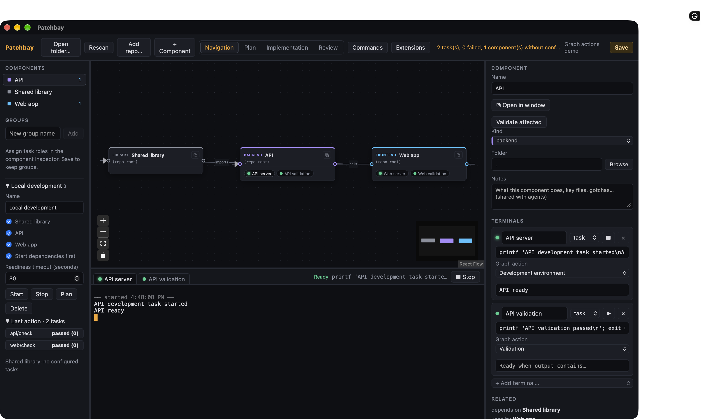

# Patchbay

See your application one component at a time. Patchbay maps a repo's main parts (frontend, API, libraries, services) as nodes on a canvas. Each node has its own live terminals (shell, dev server, tests, an AI agent) plus health at a glance. Links show what depends on what, and agents get that as context.

[](LICENSE)



> **Status:** early (0.1.0). Patchbay is developed and tested mainly on macOS; the Linux and
> Windows code paths exist but are less exercised. Expect rough edges, and please report them.

## Layout

| Path                       | What                                                                                                                 |
| -------------------------- | -------------------------------------------------------------------------------------------------------------------- |
| `crates/patchbay-core`     | Headless engine: project model, repo detection, PTY sessions, agent context, git status, device presets, policy hook |
| `crates/patchbay-cli`      | Project inspection and session lifecycle commands without the UI                                                     |
| `crates/patchbay-sessiond` | Independent local PTY service shared by desktop and CLI                                                              |
| `apps/desktop`             | Tauri 2 + React app (React Flow canvas, xterm.js terminals)                                                          |
| `devices/`                 | Built-in terminal presets (same format as user devices)                                                              |

## Getting started

There are no prebuilt releases yet, so build Patchbay from source.

Prerequisites: Rust 1.89+ (via [rustup](https://rustup.rs)), Node 20+, Git, and the
[Tauri 2 system dependencies](https://v2.tauri.app/start/prerequisites/) for your platform.

```sh
git clone https://github.com/NickGittings/Patchbay.git
cd Patchbay/apps/desktop
npm install
npm run tauri dev        # run the desktop app
npm run tauri build      # or build a local app bundle
```

The CLI exercises the same core without the UI:

```sh
cargo run -p patchbay-cli -- detect .                       # suggested component map
cargo run -p patchbay-cli -- context patchbay-core          # what an agent on that component is told
```

## Checks

Run these before opening a pull request:

```sh
cargo fmt --all -- --check
cargo clippy --workspace --all-targets -- -D warnings
cargo test --workspace                 # or: cargo nextest run --workspace
(cd apps/desktop && npm run check)     # tsc + oxlint + prettier + vitest
(cd apps/desktop && npm run smoke:all) # end-to-end smoke scripts (stop `tauri dev` first)
```

## Concepts

- **Project**: open a repo folder. Patchbay loads `patchbay.json` from the root, or, if there isn't one, detects components from `package.json`, `Cargo.toml`, `pyproject.toml`, `requirements.txt`, `go.mod`, Xcode projects/workspaces, and Android Gradle projects. Native apps use their project folder as the component; Android modules stay on their owning project's node. Review the result, then choose **Project → Create map configuration** to write `patchbay.json` (commit it to share the map). Later map edits save automatically after 750 ms of inactivity; the toolbar shows map-saving status. **Save map configuration now** and Cmd/Ctrl+S flush the current map. **Rescan** opens a selectable preview of detected additions, dependencies, stale links, missing folders, and unique package moves. **Apply selected** changes the draft and autosaves it when a map configuration already exists. Existing configuration and manual relationships survive. Inspector and hierarchy show origin and Missing, Locked, or Unreadable folders. Stop live sessions and managed environments before deleting components or repairing paths. See [map maintenance and validation](docs/map-maintenance.md).
- **Repos**: a project can span several git repos. Open a parent folder that holds them, or use **Add repo…** to add a repo that lives beside the project; it is stored as a relative path such as `../billing`, so keep the same folder layout on other machines. Any nested repo becomes a component even without a recognised manifest, and git status is tracked per repo.
- **Component**: a node with a name, kind, folder, notes and terminals. Its health shows which terminals are running, the last exit code (for example tests passing or failing), and uncommitted git changes in its folder.
- **Component window**: click ⧉ on a node, use **Open in window** in the Inspector, or double-click its hierarchy item. Each native window shows all of the component’s terminals alongside a file tree. Sessions and output are shared with the main dock; opening a window restores up to 512 KB of earlier output. Expand folders and double-click entries to open them in your preferred editor. **Open in editor** is also available in the Inspector, file tree, and review files; **Reveal in Finder/Explorer** remains a separate action. Closing the main window closes component windows while their terminals keep running; the arrangement restores next launch.
- **Terminal**: a real PTY that opens in the component's folder. Kinds are `shell` (interactive, starts when first viewed), `task` (dev server, tests…) and `agent`.
- **Link**: "depends on". Agent terminals get `PATCHBAY_CONTEXT_FILE`, a briefing with the component's notes and its related components. Claude and Codex additionally receive the briefing as native instructions and the related folders via `--add-dir`, on Unix and Windows. Other agents show a notice that the briefing was not injected automatically.
- **Device**: a terminal preset (`*.device.json`). Add your own in `~/.patchbay/devices/`.

## Task workspaces

Implementation uses goal tabs such as **Main worktree**, **Add button** or **Fix login**, and
each tab owns its terminals. **＋ New task** requires a title and creates a new branch/worktree
immediately by default; choose **Existing worktree** to attach one instead. A checkout can belong
to only one task. Non-Git projects keep the Main worktree tab only.

Plan and Implementation share the task's checkout and component scope; the scope decides what
agents are briefed on, not which terminals the tab shows. A tab lists its own terminals (a new
task starts with a stopped root shell for manual setup), the saved component terminals you add
to it with **+ Add terminal…** (a dev server, tests), and anything else running in its worktree,
such as an environment or an agent's checks. **Start agent…** launches one coordinating agent at
the worktree root; **Run…** appears once the map has groups or validation terminals. × removes a
terminal from the tab (asking first while it runs); component terminals stay on the map.
Switching tasks restores each tab's terminals, focus and maximization while other processes keep
running. The tab's ⋯ menu offers rename, notes, review, forget and worktree removal. Removal
checks for changes and cannot delete the open checkout.

Planners can submit an agreed Markdown plan and ordered component assignments:

```json
{
  "version": 1,
  "plan": "# Add button\nImplement and validate the agreed design.",
  "assignments": [{ "componentId": "web", "assignment": "Add the button and its behavior." }]
}
```

The briefing supplies stable component IDs and `"$PATCHBAY_CLI" agent propose --file proposal.json`.
Submission only creates a proposal. **Apply selection** in Plan saves its plan, assignments and
scope. Users can then adjust the scope. Editing the shared Markdown invalidates assignments
until a proposal is applied again. Implementation receives saved artifacts, separately from the
planner session and its conversation.

Agent sessions receive the packaged `patchbay-cli` path and an authenticated local desktop connection:

```sh
"$PATCHBAY_CLI" agent context
"$PATCHBAY_CLI" agent environment start GROUP_ID
"$PATCHBAY_CLI" agent environment stop GROUP_ID
"$PATCHBAY_CLI" agent validate COMPONENT_ID
"$PATCHBAY_CLI" agent status
"$PATCHBAY_CLI" agent logs SESSION_ID
```

These commands return versioned JSON and use configured action IDs. They stay bound to their
launch project/task when tabs change and require that project to remain open. Validation includes
transitive consumers and reports missing validators as incomplete checks. Environment startup
uses existing readiness, rollback and ownership rules. Results, logs, stop/rerun controls and
preview links appear in the initiating task; background results raise tab attention. Closing the
desktop disconnects these commands while service-owned processes keep running. Restart an agent
session after reopening the desktop to receive a fresh command connection.

Patchbay does not install dependencies, copy environment files, isolate ports/databases, merge
branches or delete worktrees automatically. `npm run smoke:tasks` covers proposals, root-agent
handoff, configured actions, worktree isolation and switching while commands finish.

## Editor navigation

Choose **Tools → Preferred editor…** to select VS Code (the default), Cursor, Zed, or a custom
executable. Patchbay checks your login-shell PATH and standard installation locations. If a
launcher is unavailable, editor actions open settings with setup guidance. Preferences live in
`~/.patchbay/editor.json` (or `PATCHBAY_STATE_DIR`), outside the saved component map.

Custom configuration takes an executable path/name and a JSON argument array, for example
`["--goto", "{file}:{line}:{column}"]`. Each argument stays literal, including spaces and shell
punctuation. `{folder}` is the target directory or a file's parent; `{file}` is the full target
path. Missing line/column values default to 1. Windows custom launchers must be `.exe` files.

**Cmd/Ctrl+P** searches filenames and relative paths in approved project/component folders,
with at most 100 ranked results. Git ignores hide untracked files; tracked files remain searchable.
Components in separately approved sibling repositories are included. Searches and file-tree/editor
navigation follow the active task's worktree. Review actions follow the worktree explicitly selected
for that review, including when another task is active. Changing projects/tasks discards stale
search responses. **Cmd/Ctrl+Shift+P** continues to open the command palette.

Terminal references such as `src/main.rs:12:4` and `src/main.rs(12,4)` open in the editor with
**Cmd/Ctrl-click**. Ordinary dragging still selects terminal text. Quoted filenames may contain
spaces. Relative references resolve only against that session's recorded launch directory;
missing or inaccessible targets show an explanation. Retained terminal links keep their original
process generation and launch folder across restarts and path repairs. Legacy history with an
unknown folder shows an explanation. Canonical access checks reject denied folders and symlink escapes.

Run `npm run smoke:navigation` for the Unix desktop fixture. See
[editor navigation validation](docs/editor-navigation-validation.md) for release checks.

## Extensions

Extensions are local folders containing a `package.json`. Open **Tools → Extensions…** in the
toolbar, choose **Install from folder…**, and select the extension folder. Installed folders live
in `~/.patchbay/extensions/<publisher>.<name>/`; enable/disable settings live in
`~/.patchbay/extensions.json`. **Reload** reloads manifests and restarts code hosts. Invalid
manifests stay visible with errors while other extensions continue loading. Set
`PATCHBAY_EXTENSIONS_DIR` to use another registry (including `examples/extensions`).

Manifests require `name`, `publisher`, a semantic `version`, and `engines.patchbay` (for example,
`"^0.1.0"`). `contributes` can declare devices, detectors, commands, menu placements, agent
context files, and Inspector/dock views. Each contribution id must be unique within its type
across installed extensions; use `<publisher>.<name>.<id>` for commands and views. Devices
load in built-in → extension → user order. Detectors claim folders after built-in manifest
recognition; rescanning preserves all existing edits. Context files are component-relative,
limited to 32 KiB, and checked against the same allowed roots as the file tree.

**Cmd/Ctrl+Shift+P** opens the command palette. Commands with a `run` block create a temporary
terminal at the selected component, using the existing session, policy, and PTY launch path.
These terminals appear in the dock without changing the saved project. Place commands in
`contributes.menus["component/actions"]` or `contributes.menus.toolbar` (listed under **Tools**).
Optional `when` clauses support `&&`, `||`, `!`, parentheses, `==`, `!=`, `component.kind`, `component.id`,
`component.hasTerminal('id')`, `component.hasFile('file')`, and `view`. Unknown or malformed
expressions hide the contribution.

For code, set `main` to an ES module exporting `activate(patchbay)` and optionally
`deactivate()`. Activation events are `onStartup`, `onProjectOpen`, `onCommand:<id>`,
`onView:<id>`, and `workspaceContains:<file>`; first command/view use also activates its owner.
Each project/task retains its own host when tabs or tasks change. Disabling an extension and Reload dispose its hosts. Code runs only in the
main window, in opaque-origin `sandbox="allow-scripts"` frames. The broker binds each request
to its sending frame, checks permissions, bounds messages and concurrent calls, and stops
hosts that stop answering (three timeouts in a row) or send excessive traffic; a single slow
call just fails. Commands have a 60-second deadline. Extension frames receive no Tauri API. CSP blocks
network/IPC connections; asset requests are canonicalized inside their extension directory.

The API declarations are in [`packages/extension-api/index.d.ts`](packages/extension-api/index.d.ts).
Use `project:read` for project/selection snapshots, Git status, and badge/context providers;
`terminals` for terminal launches; `files:read` for bounded project file reads;
`sessions:read` for component task-terminal URL summaries; and the separate `urls:open`
permission for native-validated HTTP/HTTPS browser opening. `workspace.get` reports the
host’s stable project/task identity. Commands and file reads use that task’s worktree. Storage is
per extension under `~/.patchbay/extension-data/` (alongside an overridden registry). No raw
filesystem or network API is exposed. `terminals.run` returns captured output and exit status,
or `running: true` after eight seconds for a longer task; its session remains in the dock
(without taking focus), and running the same command again in that component reuses it. An
extension keeps at most eight such sessions. Extension context in a briefing is capped at 128 KiB.
Context and badge providers have a two-second response deadline. Views use
`views.registerWebviewView(id, { resolve(view), onMessage(message) })`; `view.render(html)`
mounts sandboxed HTML, and `patchbayView.postMessage` / `patchbayView.onMessage` communicate
with the extension's handler. HTML may use inline styles and scripts, with no network access.

[`examples/extensions/docker`](examples/extensions/docker) demonstrates every declarative
contribution plus container counts from a terminal task, agent context, and an Inspector view.
Its fixture uses Compose; Docker is optional for smoke verification (missing or failing
Docker displays an error and preserves the last successful result). Run `PATCHBAY_EXTENSIONS_DIR=examples/extensions cargo run -p patchbay-cli -- extensions`
or `... -- detect examples/extensions/docker/fixture` to inspect it. `npm run smoke:extensions`
checks the example inside the desktop app, including the iframe IPC sandbox. Project-local
extensions, marketplace/URL installs, and extension views in pop-out windows are future work.

Supported first-party Docker and browser preview folders are in [`extensions`](extensions/README.md).
They remain sandboxed and locally installed, with explicit refresh and task-scoped state.

## Workspace continuity

Projects open in separate tabs. Each canonical folder has a persistent local identity;
Git worktrees and copied folders remain separate projects even when their component IDs
match. Switching tabs keeps drafts, selection, planner scope, view, panel sizes, viewport,
terminals and component windows. Closing a tab detaches its work; **Sessions** continues to
show it, grouped by project.

Closing windows and quitting Patchbay leave shells, tasks and agents running in the
independent `patchbay-sessiond` helper. **Stop** terminates a session and cancels coordinated
startup only when its plan includes that session; stopping one validator lets validation
continue. **Stop all work** asks for confirmation, then cancels coordinated actions and stops
sessions across every project, including those hidden by filters, while keeping Patchbay
open. From the CLI, `patchbay sessions shutdown --stop-running` stops all work and shuts down
the helper. Sessions show **Disconnected** while the desktop reconnects; losing a connection
never starts replacement processes. The helper exits after 60 seconds without clients or
running processes.

Local recovery lives in `~/.patchbay/workspaces/default.json`; identities live beside it.
Drafts are written atomically after 500 ms of inactivity and flushed on orderly main-window
closure. Map autosave separately writes existing `patchbay.json` configurations after 750 ms
of inactivity and flushes on orderly closure. A missing configuration requires an explicit
**Create map configuration** first. Failed saves retain the recovery draft and show **Retry**.
External map edits pause autosave; the status menu offers **Reload saved map** or
**Replace with my map**. When the saved map changed while Patchbay was closed, choose
**Recover draft** or **Use saved map**. Missing folders remain
visible with **Locate folder…** and **Remove**. Restored external folders remain locked until
their grants are revalidated through Browse or Add repo.

The private `~/.patchbay/sessiond/` directory contains the versioned loopback endpoint,
credentials and session history. Only the native host connects; credentials are never
sent to webviews. Each process incarnation retains at most 512 KiB of output. Older
incarnations remain accessible in Sessions until **Forget** removes an ended session.
Replay is bounded scrollback, not an exact reconstruction of every full-screen application.
Service crashes and machine reboots mark prior work **Interrupted**; recovery is explicit.
Moved folders must be relinked, and a resumed conversation still needs its recorded working
directory and provider history.

Agent terminals/devices accept `"adapter": "claude"` or `"adapter": "codex"`. Recognized direct
provider commands get defaults; select an adapter for a custom command. **Reconnect**
attaches to a live process. **Resume conversation** explicitly resumes an ended conversation
by its stored provider ID, separately from its PTY ID and process generation. Recognized
resume instructions capture an exact ID; otherwise use **Set conversation ID**. Patchbay
never selects the newest conversation in a directory. Resume preserves launch options and
Patchbay context. Unsupported compound/wrapper commands report an error when their options
cannot be preserved safely. See the [Claude CLI reference](https://code.claude.com/docs/en/cli-reference)
and [Codex CLI documentation](https://learn.chatgpt.com/docs/developer-commands?surface=cli).

**Tools → Agent status integration…** provides opt-in Claude/Codex status hooks. Install,
check, or remove Patchbay-owned entries in the active user hook source while preserving
existing settings. Codex definitions require review/trust through `/hooks`; Patchbay retains
output-based Active/Quiet until native reporting is confirmed. Confirmed hooks report Working,
Needs input, Ready for review, Idle, and Ended, including quiet working turns. See
[setup details and remaining platform/provider release gates](docs/agent-status-validation.md).

```sh
cargo build -p patchbay-cli -p patchbay-sessiond
./target/debug/patchbay-cli sessions list
./target/debug/patchbay-cli sessions attach SESSION_ID   # Ctrl+] detaches
./target/debug/patchbay-cli sessions stop SESSION_ID
./target/debug/patchbay-cli sessions set-conversation SESSION_ID PROVIDER_ID
./target/debug/patchbay-cli sessions resume SESSION_ID
./target/debug/patchbay-cli sessions forget SESSION_ID
./target/debug/patchbay-cli sessions shutdown            # refuses if work is running
./target/debug/patchbay-cli sessions shutdown --stop-running
```

Development and Tauri packaging build and copy the helper automatically. Standalone CLI
installations need `patchbay-sessiond` beside `patchbay`. `PATCHBAY_STATE_DIR` selects isolated
local state for tests; it must be an absolute path. `npm run smoke:workspace` accepts a second
fixture through `PATCHBAY_SMOKE_ROOT_2`. `npm run smoke:lifecycle` creates isolated fixtures,
quits and relaunches the desktop, and verifies the same process and recovered workspace.
`PATCHBAY_SMOKE_PORT` can select a free port for that harness.

## Graph actions

Use **Groups** beneath the component hierarchy to save reusable component sets in
`patchbay.json`. New groups include the selected canvas components; expand a group to edit
membership. **Plan** uses the group as the planner scope. Groups and task roles autosave once a map configuration exists.

In the component inspector, assign each task terminal a **Graph action**: **Development
environment**, **Validation**, or **Manual only** (the default). Shells and agents are never
started by graph actions. Commands are opt-in; detection (including extension detectors) never assigns a role. A role on a
terminal that isn't a task with a command only fails the action that would run it.

A group's **Start** launches its development tasks together. **Start dependencies first**
opts into dependency ordering within that group: targets start before their consumers.
Components in the same stage start together. A task's configured **Ready when output contains…**
text gates successful startup and the next stage; the match ignores case and terminal escapes. A printed URL cannot
bypass explicit readiness text. Without readiness text, spawning is the only startup gate.
Each group's **Readiness timeout** (whole seconds, 1–3600) bounds how long a task may take to
print its readiness text, ordered or not. Dependencies outside the group are not automatically started. Ordering cycles fail before
any task launches. Readiness timeouts or early exits roll back tasks launched by that attempt.

**Stop** cancels pending startup and stops the group's managed tasks in reverse startup order,
escalating to kill stubborn processes. Tasks shared by another started group keep running.
Manually started tasks are reused but remain outside group ownership. Deleting a group stops
its managed tasks first. Environment ownership lives in the session service; configuration is saved separately.
Switching projects or tasks keeps environments and other terminals running.

**Validate affected** runs the component's validation tasks and the validation tasks of every
transitive consumer, once each. Validation runs sequentially and continues after nonzero exits.
An already-running validation task blocks the run. Components without configured validators
are reported as skipped. Locked or missing component folders fail before any command launches.
Results appear under Groups; click a result to open its terminal output. Stopping one
validator's terminal marks it stopped and moves on; **Stop validation** stops the running one and
reports the rest as not run, keeping earlier results. Only one coordinated graph action runs at a time.

With a task active, graph actions run in its worktree under its session ids, and each task keeps
its own environment per group. A group or validation that needs a component outside the task's
repository fails before anything launches.

`npm run smoke:actions` exercises task roles, group configuration, ordered startup, readiness,
shutdown, affected validation, terminal results, planner reuse and project reset in the app.

## Contributing

Issues and pull requests are welcome. For anything larger than a small fix, please open an issue
first to discuss the approach. Run the [checks](#checks) before submitting. [`CLAUDE.md`](CLAUDE.md)
describes the architecture, the Rust ↔ TypeScript types that must stay in sync, and the test
setup, and is a good map of the codebase for humans and agents alike.

By contributing, you agree that your contributions are licensed under the project's MIT license.

## License

Patchbay is released under the [MIT License](LICENSE).
